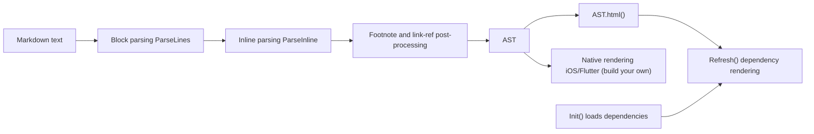

Last updated: 2026-10-20

> [!NOTE]
> This README was generated by [SKILL](https://github.com/agenvoy/skill-readme-generate), get the ZH version from [here](./doc/README.zh.md).

***

<strong>FAST MARKDOWN TO AST AND HTML IN ONE PARSER!</strong>

***

> A TypeScript Markdown parser with a JSON AST, on-demand Mermaid/KaTeX/Chart.js rendering, and sanitized HTML output

## Table of Contents

- [Features](#features)
- [v1 vs v2](#v1-vs-v2)
- [Architecture](#architecture)
- [License](#license)
- [Author](#author)

## Features

> `npm i @pardnchiu/nanomd` · [Documentation](./doc/doc.md) · [v1 Deprecation](./doc/v1-deprecated.md) · [Docs Site](https://nanomd.pardn.io/)

- **Single-Pass Line Parser** — Each line is scanned once to build the whole tree; a 4 MB document renders in about 150 ms, at least 7 times faster than v1 and more than 230 times faster at 1 MB.
- **Renderer-Agnostic AST** — `Parse()` returns a node tree you can `JSON.stringify`; the web and SSR use `html()` directly, and native renderers for iOS or Flutter can be built on the same output.
- **Extended Syntax Beyond GFM** — Footnotes, reference links, GitHub alerts, task lists, inline and block math, image sizing and video embeds are built in.
- **On-Demand Dependencies with Fallbacks** — Only the enabled Mermaid, KaTeX, Chart.js and prettify load, and invalid blocks fall back to plain code blocks.
- **Safe by Default** — Text and attributes are escaped at output, and raw HTML loses dangerous tags, event attributes and `javascript:` URLs.

## v1 vs v2

The same sample document, repeated to each size, rendered to HTML in headless Chrome; runs over 15 seconds are recorded as timeouts, and their ratios use 15 seconds as a lower bound.

| Size | v1.11.6 `MDParser().parse()` | v2 `Parse().html()` | Speedup |
|---|---|---|---|
| 4.4 KB | 2.6 ms | 0.4 ms | 7× |
| 44.3 KB | 29.6 ms | 1.8 ms | 16× |
| 443.4 KB | 1,790 ms | 17.7 ms | 101× |
| 1.08 MB | 11,037 ms | 47.4 ms | 233× |
| 2.16 MB | Timeout | 82.3 ms | 182× or more |
| 4.33 MB | Timeout | 156.4 ms | 96× or more |

## Architecture

> [Full Architecture](./doc/architecture.md)

## License

This project is licensed under the [MIT LICENSE](LICENSE).

## Author

Just [open an issue](https://github.com/pardnchiu/NanoMD/issues/new) to share an idea.

***

©️ 2024 [邱敬幃 Pardn Chiu](https://www.linkedin.com/in/pardnchiu)
