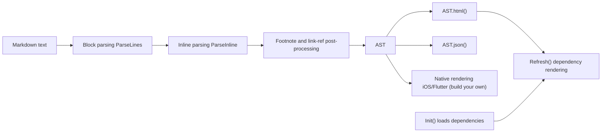

Last updated: 2026-10-20

> [!NOTE]
> This README was generated by [SKILL](https://github.com/agenvoy/skill-readme-generate), get the ZH version from [here](./doc/README.zh.md).

***

<strong>FAST MARKDOWN TO AST AND HTML IN ONE PARSER!</strong>

***

> A TypeScript Markdown parser with a JSON AST, on-demand Mermaid/KaTeX/Chart.js rendering, and sanitized HTML output

## Table of Contents

- [Features](#features)
- [Benchmark](#benchmark)
- [Architecture](#architecture)
- [License](#license)
- [Author](#author)

## Features

> `npm i @pardnchiu/nanomd` · [Documentation](./doc/doc.md) · [v1 Deprecation](./doc/v1-deprecated.md) · [Docs Site](https://nanomd.pardn.io/)

- **Single-Pass Line Parser** — Each line is scanned once to build the whole tree; a 4 MB document renders in about 90 ms, over 30 times faster than v1 and more than 380 times faster at 1 MB.
- **Renderer-Agnostic AST** — `Parse()` returns a node tree and `json()` copies it out as plain data; the web and SSR use `html()` directly, and native renderers for iOS or Flutter can be built on the same output.
- **Extended Syntax Beyond GFM** — Footnotes, reference links, GitHub alerts, task lists, inline and block math, image sizing, video embeds and `#tag` links are built in.
- **On-Demand Dependencies with Fallbacks** — Only the enabled Mermaid, KaTeX, Chart.js and prettify load, and invalid blocks fall back to plain code blocks.
- **Safe by Default** — Text and attributes are escaped at output, and raw HTML loses dangerous tags, event attributes and `javascript:` URLs.

## Benchmark

The documentation pages of the [docs site](https://nanomd.pardn.io/) joined into one document and repeated to each size, rendered to HTML in headless Chrome 155 on macOS with v1.11.6, v2 and marked 18.1.1. Each case warms up 5 runs, then repeats for at least 1.5 seconds and shows the average; a call that takes over 3 seconds is measured once, and one that takes over 15 seconds is recorded as a timeout. See [NanoMD vs marked](https://nanomd.pardn.io/vs-marked) for side-by-side rendering and an in-browser benchmark.

| Size | v1.11.6 `new MDParser().parse()` | v2 `Parse().html()` | marked `marked.parse()` | v1 / v2 | marked / v2 |
|---|---|---|---|---|---|
| 6.1 KB | 3.23 ms | 0.097 ms | 0.127 ms | 33× | 1.30× |
| 42.2 KB | 26.9 ms | 0.87 ms | 1.08 ms | 31× | 1.24× |
| 405.2 KB | 1,402 ms | 9.15 ms | 10.2 ms | 153× | 1.11× |
| 1.00 MB | 8,853 ms | 23.1 ms | 26.3 ms | 383× | 1.14× |
| 2.00 MB | Timeout (over 15 s) | 44.6 ms | 53.9 ms | Timeout | 1.21× |
| 4.00 MB | Timeout (over 15 s) | 88.3 ms | 101.7 ms | Timeout | 1.15× |

## Architecture

> [Full Architecture](./doc/architecture.md)

## License

This project is licensed under the [MIT LICENSE](LICENSE).

## Author

Just [open an issue](https://github.com/pardnchiu/NanoMD/issues/new) to share an idea.

***

©️ 2024 [邱敬幃 Pardn Chiu](https://www.linkedin.com/in/pardnchiu)
