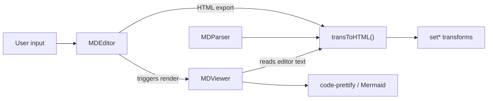

> [!NOTE]
> This README was generated by [SKILL](https://github.com/agenvoy/skill-readme-generate), get the ZH version from [here](./doc/README.zh.md).

***

<strong>LIGHTWEIGHT MARKDOWN EDITOR IN PURE JAVASCRIPT!</strong>

***

> A pure JavaScript Markdown library with a synced editor and viewer, a shared parsing pipeline, and Mermaid-ready extended syntax

## Table of Contents

- [Features](#features)
- [Architecture](#architecture)
- [License](#license)
- [Author](#author)

## Features

> `npm i @pardnchiu/nanomd` · [Documentation](./doc/doc.md) · [Docs Site](https://nanomd.pardn.io/)

- **Live Editor and Viewer Sync** — Bind `MDViewer` to `MDEditor` and the preview re-renders once typing pauses, with optional wheel-driven scroll sync.
- **One Pipeline for All Components** — The editor, the viewer and the standalone `MDParser` all go through the same `transToHTML()`, so syntax behaves identically everywhere.
- **Standard and Extended Syntax** — Extended mode adds GitHub-style alerts, Mermaid diagrams, marker and sub/superscript, image sizing, and YouTube/Vimeo embeds.
- **Embed With One Script** — No framework required; a single file pulls in its own styles, code highlighting and Mermaid.
- **Full Editing Toolkit** — Built-in shortcuts, snapshot undo/redo, a floating toolbar, Markdown/HTML export and file import.

## Architecture

> [Full Architecture](./doc/architecture.md)

## License

This project is licensed under the [MIT LICENSE](LICENSE).

## Author

Just [open an issue](https://github.com/pardnchiu/NanoMD/issues/new) to share an idea.

***

©️ 2024 [邱敬幃 Pardn Chiu](https://www.linkedin.com/in/pardnchiu)
