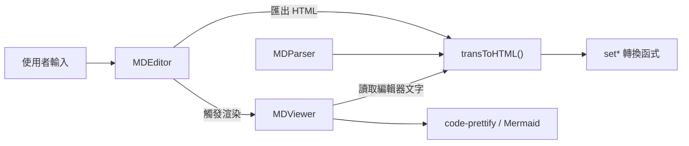

> [!NOTE]
> 此 README 由 [SKILL](https://github.com/agenvoy/skill-readme-generate) 生成，英文版請參閱 [這裡](../README.md)。

***

<strong>LIGHTWEIGHT MARKDOWN EDITOR IN PURE JAVASCRIPT!</strong>

***

> 純 JavaScript Markdown 函式庫，具備同步編輯預覽、共用轉換管線與支援 Mermaid 的擴充語法

## 目錄

- [功能特點](#功能特點)
- [架構](#架構)
- [授權](#授權)
- [Author](#author)

## 功能特點

> `npm i @pardnchiu/nanomd` · [完整文件](./doc.zh.md) · [文件站](https://nanomd.pardn.io/zh/)

- **編輯器與預覽器即時同步** — `MDViewer` 綁定 `MDEditor` 後，停止輸入即重新渲染，並可跟隨滾輪同步捲動。
- **三元件共用單一轉換管線** — 編輯器、預覽器與獨立的 `MDParser` 都走同一個 `transToHTML()`，任何情境下語法行為一致。
- **標準與擴充雙模式語法** — 擴充模式支援 GitHub 提示框、Mermaid 圖表、標記與上下標、圖片尺寸與 YouTube／Vimeo 嵌入。
- **一個 script 即可嵌入** — 不依賴任何框架，載入單一檔案即自動帶入樣式、程式碼高亮與 Mermaid。
- **完整的編輯體驗** — 內建快捷鍵、快照式復原／重做、浮動工具列，以及 Markdown／HTML 匯出與檔案匯入。

## 架構

> [完整架構](./architecture.zh.md)

## 授權

本專案採用 [MIT LICENSE](../LICENSE)。

## Author

Just [open an issue](https://github.com/pardnchiu/NanoMD/issues/new) to share an idea.

***

©️ 2024 [邱敬幃 Pardn Chiu](https://www.linkedin.com/in/pardnchiu)
