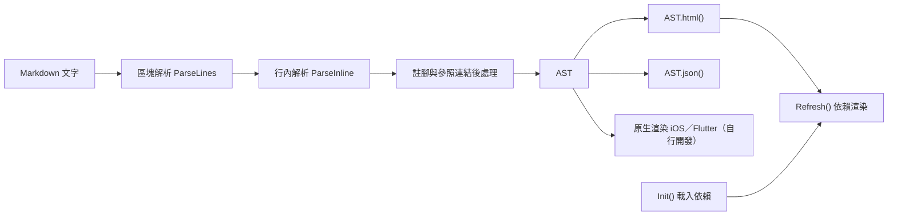

最後更新：2026-10-20

> [!NOTE]
> 此 README 由 [SKILL](https://github.com/agenvoy/skill-readme-generate) 生成，英文版請參閱 [這裡](../README.md)。

***

<strong>FAST MARKDOWN TO AST AND HTML IN ONE PARSER!</strong>

***

> TypeScript Markdown 解析器，具備 JSON AST、按需載入的 Mermaid／KaTeX／Chart.js 渲染與安全的 HTML 輸出

## 目錄

- [功能特點](#功能特點)
- [v1／v2 比較](#v1v2-比較)
- [架構](#架構)
- [授權](#授權)
- [Author](#author)

## 功能特點

> `npm i @pardnchiu/nanomd` · [完整文件](./doc.zh.md) · [v1 停用說明](./v1-deprecated.zh.md) · [文件站](https://nanomd.pardn.io/)

- **單趟逐行解析** — 每行只掃描一次即建好整棵樹，4 MB 文件約 150 ms，比 v1 快 7 倍起，1 MB 文件差距超過 230 倍。
- **與渲染無關的 AST** — `Parse()` 回傳節點樹，`json()` 可複製成純資料，Web 與 SSR 直接用 `html()`，iOS、Flutter 等原生渲染可依同一份結果自行開發。
- **GFM 之外的擴充語法** — 註腳、參照式連結、GitHub 提示框、任務清單、行內與區塊數學式、圖片尺寸、影片嵌入與 `#tag` 連結皆內建。
- **依賴按需載入並自動退回** — 只載入啟用的 Mermaid、KaTeX、Chart.js、prettify；語法錯誤的區塊自動改顯示為一般程式碼區塊。
- **輸出即安全** — 文字與屬性在輸出時跳脫，raw HTML 移除危險標籤、事件屬性與 `javascript:` 網址。

## v1／v2 比較

同一份範例文件重複放大後，在 headless Chrome 量測轉成 HTML 的耗時；超過 15 秒記為超時，超時列的倍數以 15 秒計算為下限。

| 文件大小 | v1.11.6 `MDParser().parse()` | v2 `Parse().html()` | 倍數 |
|---|---|---|---|
| 4.4 KB | 2.6 ms | 0.4 ms | 7× |
| 44.3 KB | 29.6 ms | 1.8 ms | 16× |
| 443.4 KB | 1,790 ms | 17.7 ms | 101× |
| 1.08 MB | 11,037 ms | 47.4 ms | 233× |
| 2.16 MB | 超時 | 82.3 ms | 182× 以上 |
| 4.33 MB | 超時 | 156.4 ms | 96× 以上 |

## 架構

> [完整架構](./architecture.zh.md)

## 授權

本專案採用 [MIT LICENSE](../LICENSE)。

## Author

Just [open an issue](https://github.com/pardnchiu/NanoMD/issues/new) to share an idea.

***

©️ 2024 [邱敬幃 Pardn Chiu](https://www.linkedin.com/in/pardnchiu)
