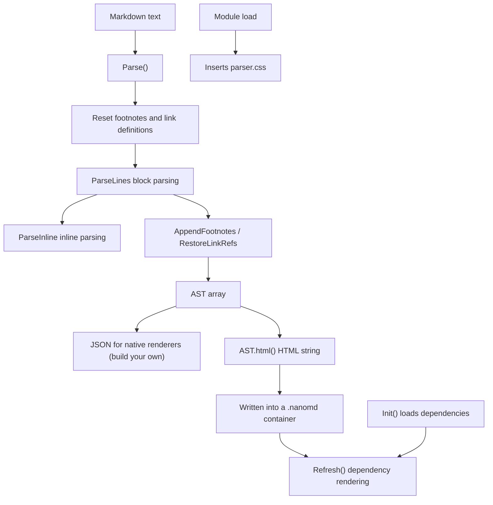
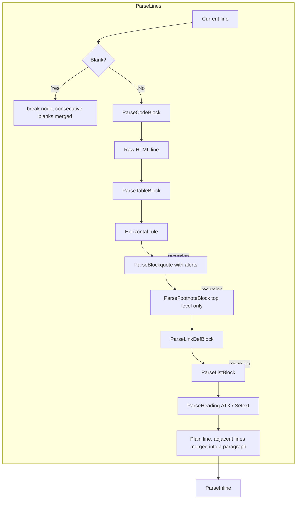
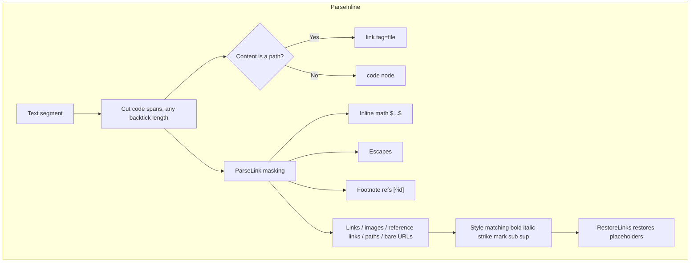
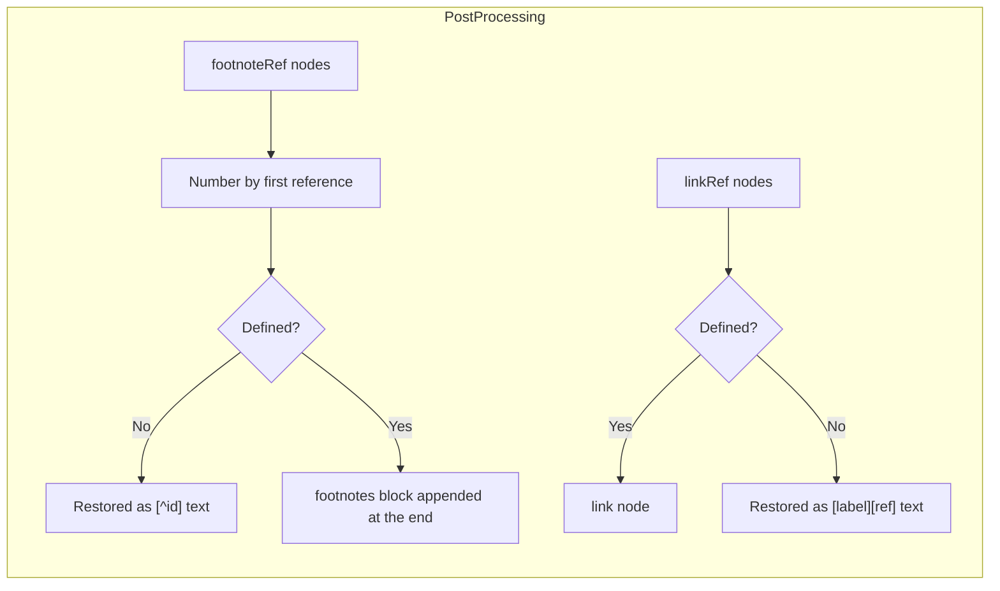
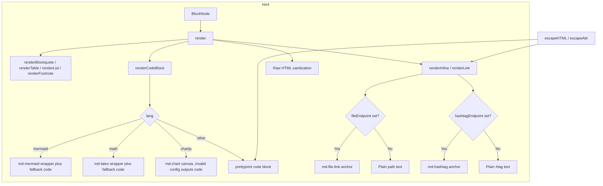
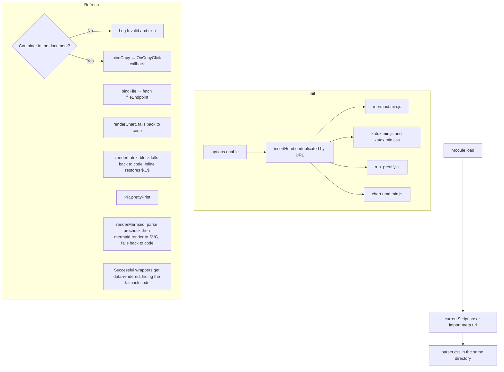
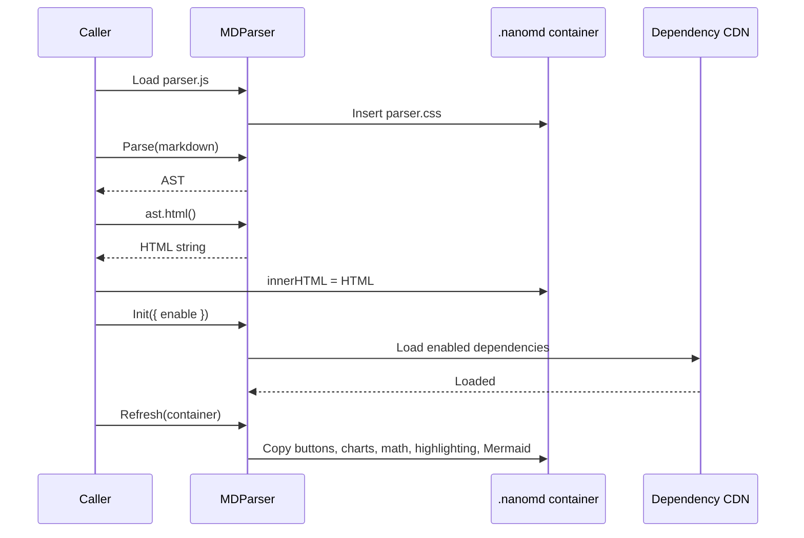

# NanoMD - Architecture

Last updated: 2026-10-20

> Back to [README](../README.md)

## Overview

## Module: Block Parsing (ParseLines)

Each line is classified in priority order; nested content (blockquotes, list items, footnotes) calls `ParseLines` recursively.

## Module: Inline Parsing (ParseInline)

Code spans are cut out first; the remaining segments mask content that must not be styled with placeholders, then styles are matched.

## Module: Post-Processing

Nodes that need whole-document information are resolved once parsing finishes.

## Module: HTML Output (AST.html)

`AST` extends `Array` and `html()` lives on its prototype; output is chosen by node type and escaping happens at output time.

## Module: Dependencies and Runtime (Init / Refresh)

`Init` only loads; `Refresh` renders on DOM that is already in place. Both read dependencies only from globals that already exist.

## Data Flow

***

©️ 2024 [邱敬幃 Pardn Chiu](https://www.linkedin.com/in/pardnchiu)
