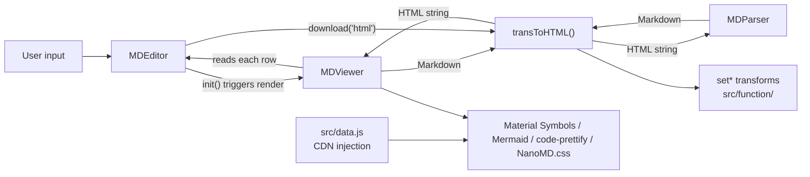
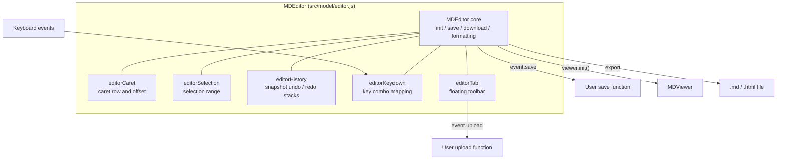
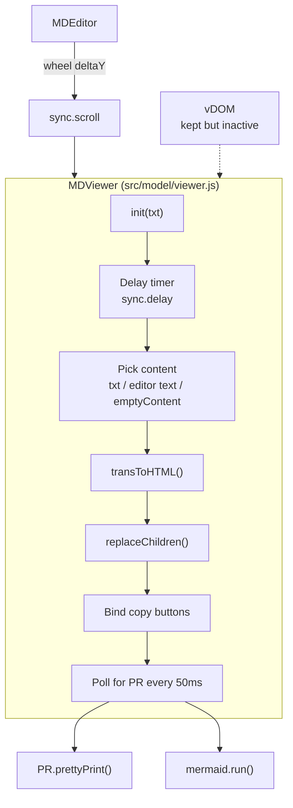
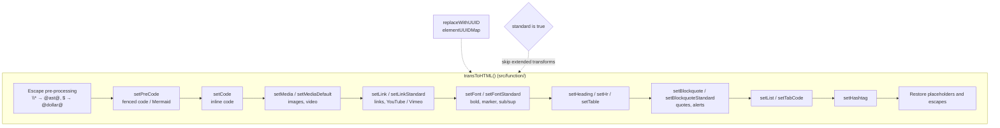
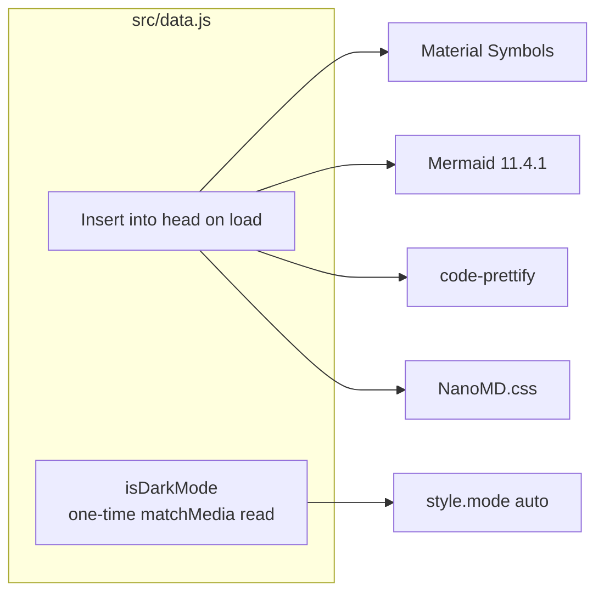
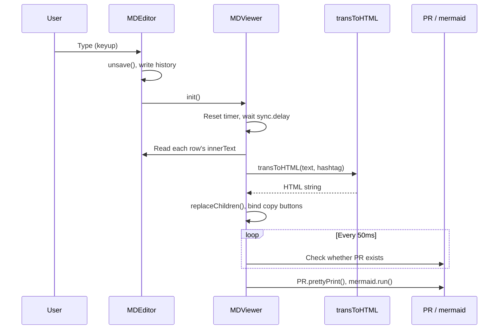
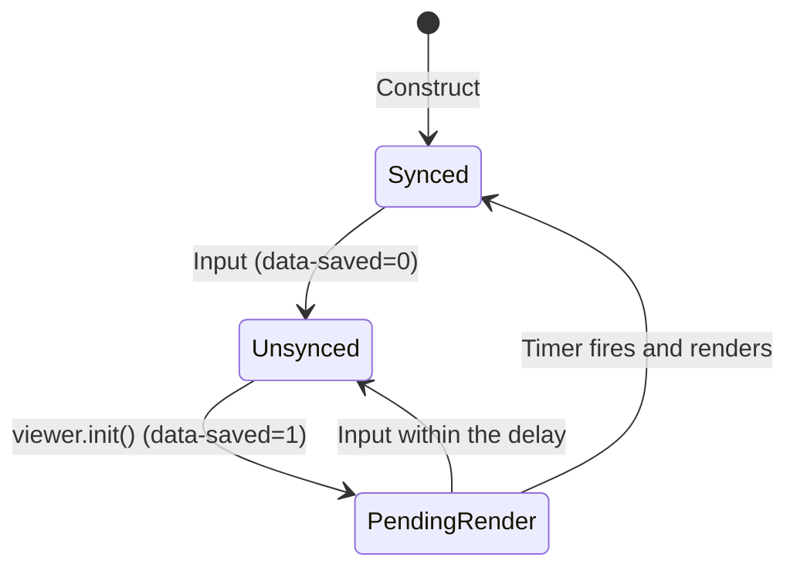

# NanoMD - Architecture

> Back to [README](../README.md)

## Overview

None of the three components parses Markdown itself; all call the same `transToHTML()`. `MDViewer` passes its hashtag settings and always uses extended mode, `MDParser` passes its `standard` flag, and `MDEditor` calls it only when exporting HTML.

## Module: MDEditor

A `contentEditable` editor where each row is a `
`; sub-modules handle the caret, selection, history, shortcuts and toolbar.

## Module: MDViewer

A debounced preview container that wires copy buttons, code highlighting and Mermaid after each render.

## Module: Parsing Pipeline

`transToHTML()` runs the transforms in a fixed order; converted fragments are isolated as `{{tag-uuid}}` placeholders and restored once at the end.

## Module: Runtime Resources

## Data Flow

## State Machine

***

©️ 2024 [邱敬幃 Pardn Chiu](https://www.linkedin.com/in/pardnchiu)
