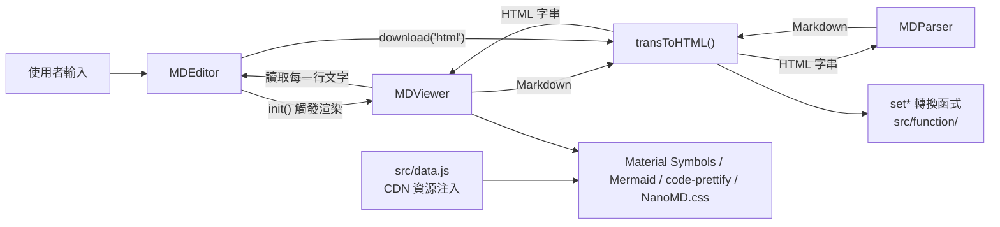
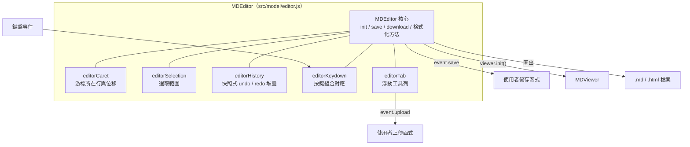
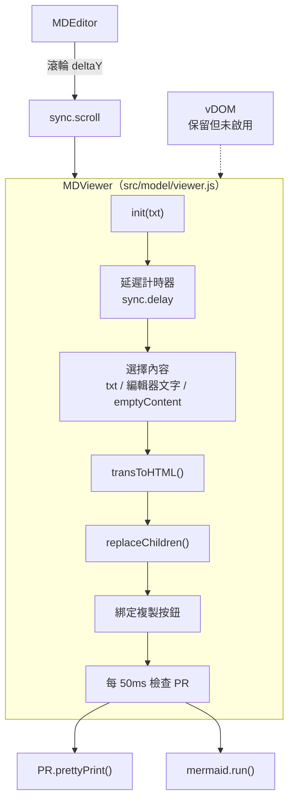
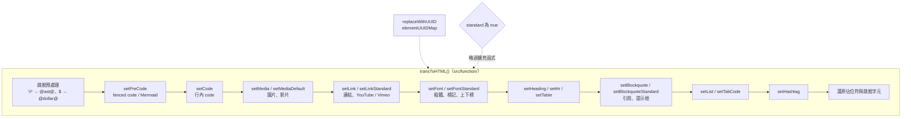
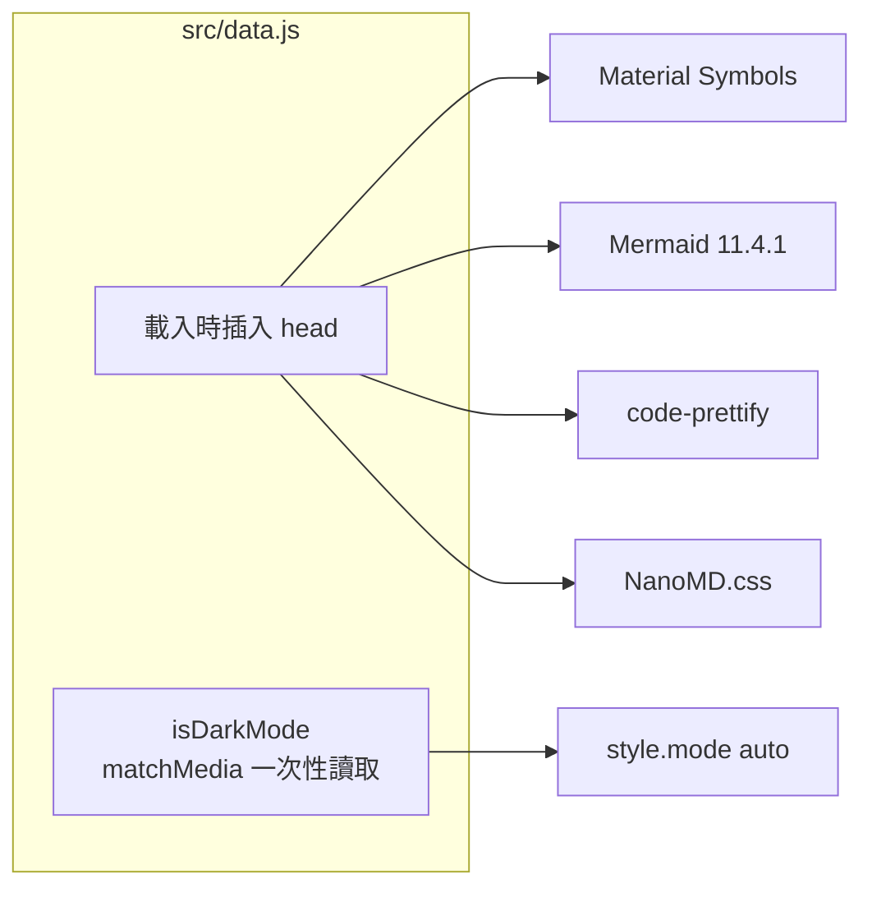
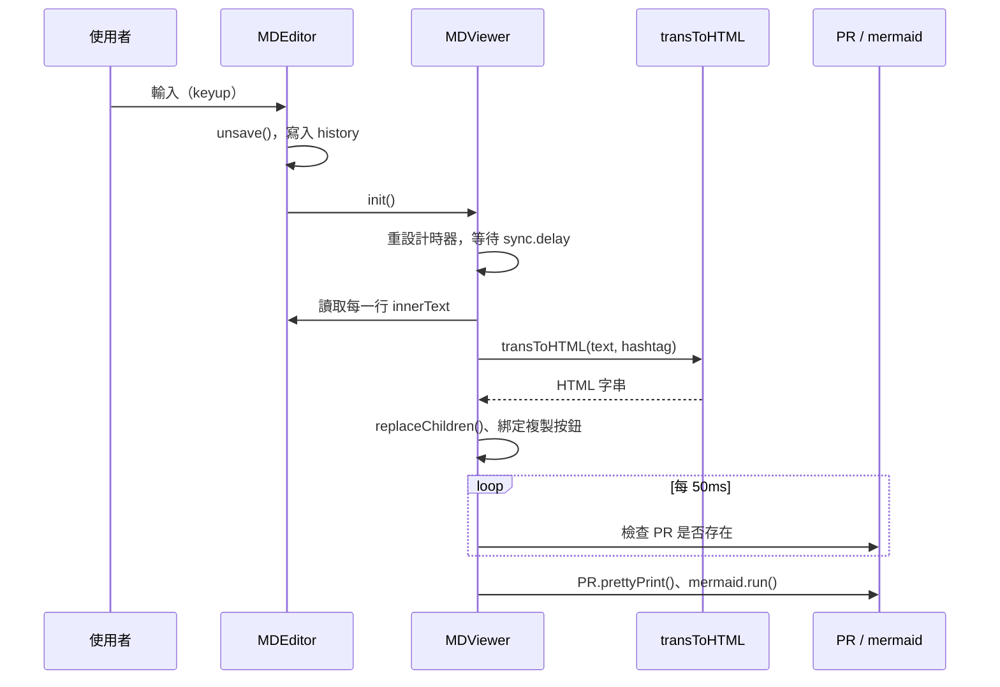
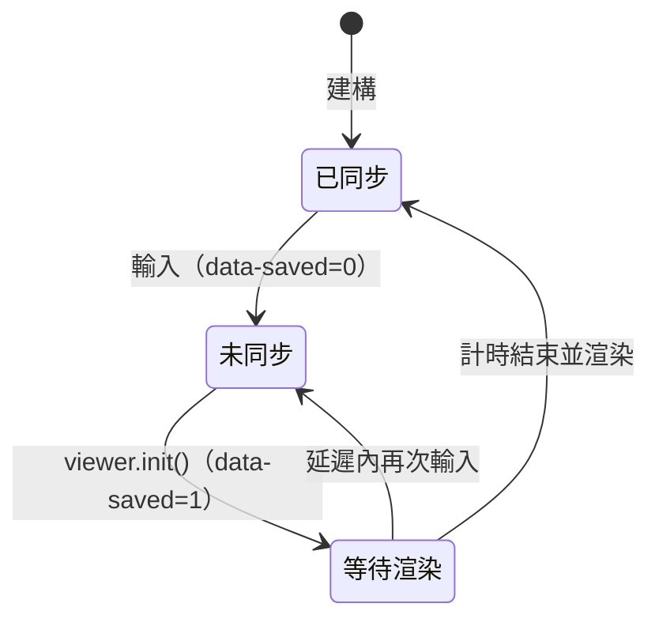

# NanoMD - 架構

> 返回 [README](./README.zh.md)

## 概覽

三個元件都不自行解析 Markdown，全部呼叫同一個 `transToHTML()`：`MDViewer` 帶入 hashtag 設定並固定使用擴充模式，`MDParser` 帶入 `standard` 旗標，`MDEditor` 只在匯出 HTML 時呼叫。

## Module: MDEditor

`contentEditable` 編輯器，每一行是一個 `
`，由子模組處理游標、選取、歷史、快捷鍵與工具列。

## Module: MDViewer

延遲渲染的預覽容器，渲染後處理複製按鈕、程式碼高亮與 Mermaid。

## Module: 轉換管線

`transToHTML()` 依固定順序執行轉換函式，已轉換的片段以 `{{tag-uuid}}` 佔位隔離，最後一次還原。

## Module: 執行期資源

## 資料流

## 狀態機

***

©️ 2024 [邱敬幃 Pardn Chiu](https://www.linkedin.com/in/pardnchiu)
