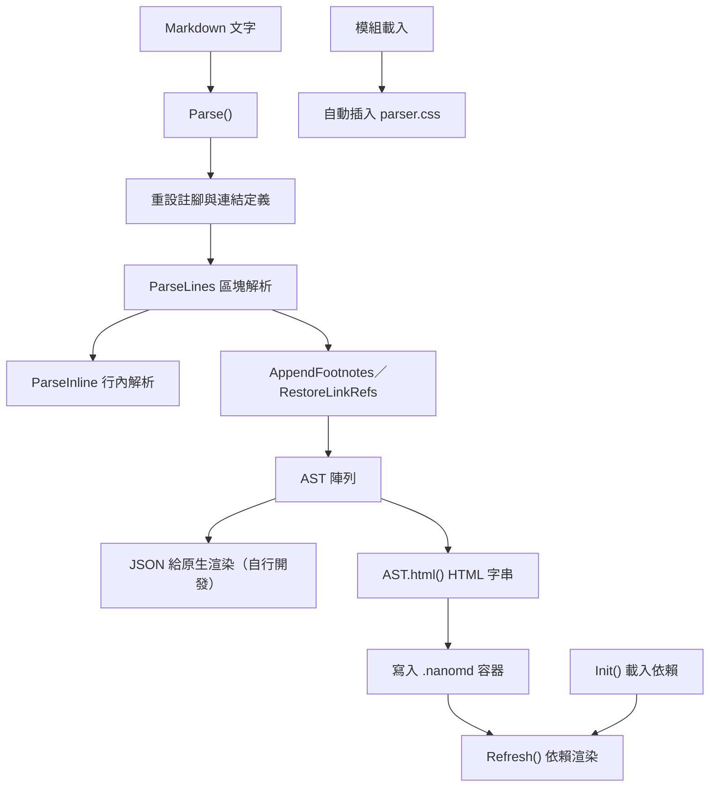
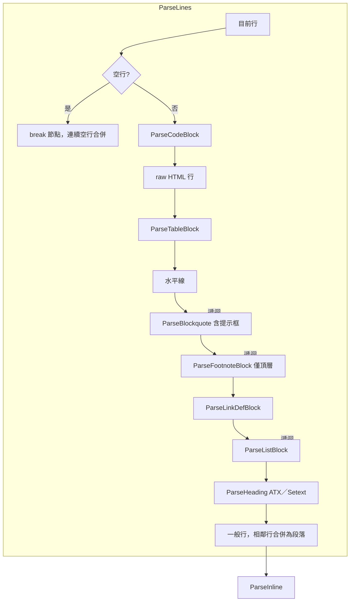
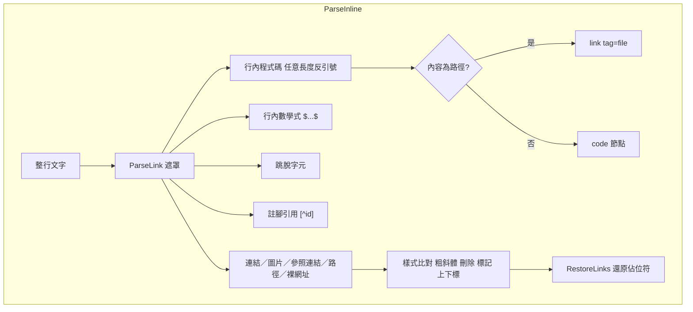
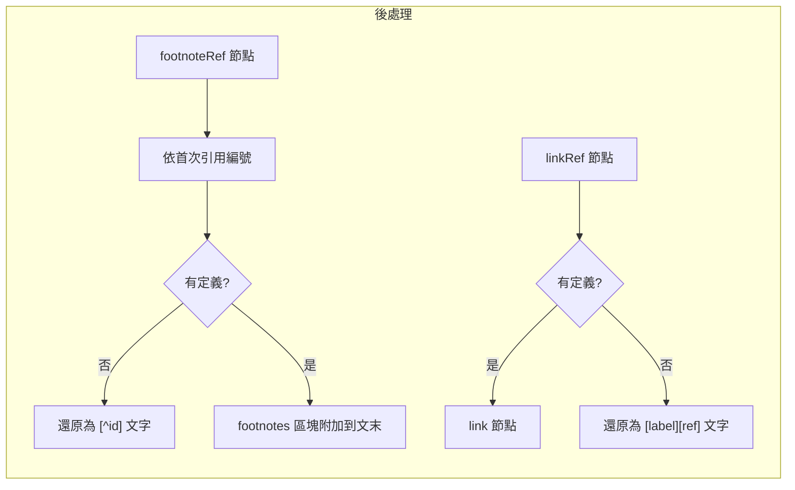
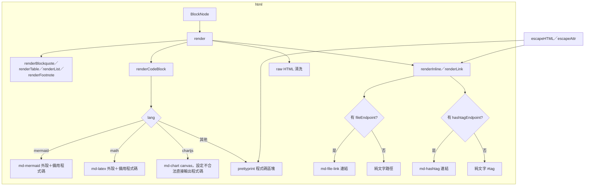
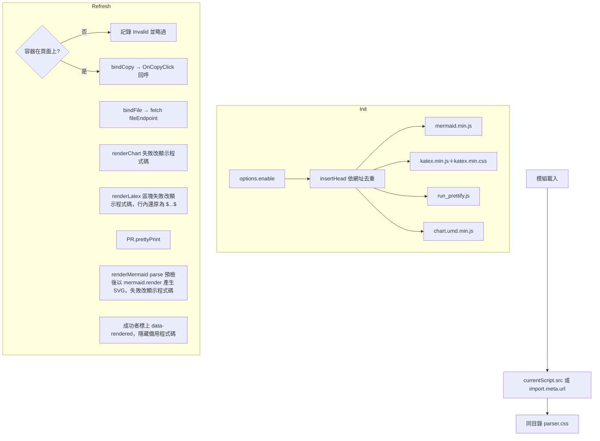
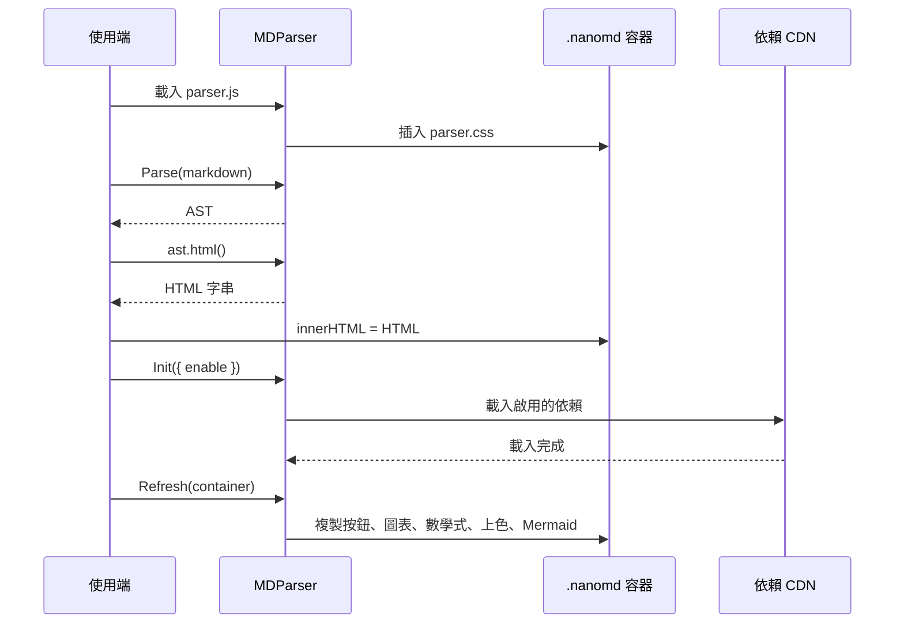

# NanoMD - 架構

最後更新：2026-10-21

> 返回 [README](./README.zh.md)

## 概覽

## Module: 區塊解析（ParseLines）

逐行判斷區塊類型，判斷順序即優先權；巢狀內容（引言、清單項目、註腳）遞迴呼叫 `ParseLines`。

## Module: 行內解析（ParseInline）

整行先以佔位符遮罩不可再被樣式比對的內容（含行內程式碼），再比對樣式，因此樣式可跨越行內程式碼。

## Module: 後處理

解析完成後一次處理需要全文資訊的節點。

## Module: HTML 輸出（AST.html）

`AST` 繼承 `Array`，`html()` 掛在 prototype，依節點類型輸出，跳脫在輸出時進行。

## Module: 依賴與執行期（Init／Refresh）

`Init` 只負責載入，`Refresh` 在已輸出的 DOM 上渲染；兩者都只讀取全域上已存在的依賴。

## 資料流

***

©️ 2024 [邱敬幃 Pardn Chiu](https://www.linkedin.com/in/pardnchiu)
