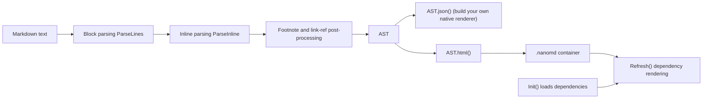

# Architecture

NanoMD separates parsing from rendering into independent layers: parsing only produces data, while HTML output and dependency rendering are optional downstream steps.

Other JavaScript Markdown libraries cover adjacent ground: marked is a parser and compiler built for speed, markdown-it offers full CommonMark support with syntax plugins, markdown-exit is a TypeScript rewrite of markdown-it, showdown converts in both directions between Markdown and HTML, remark is a plugin-based processor in the unified collective, and micromark is a small CommonMark-compliant parser; each grows past core Markdown through plugins or extensions. NanoMD takes a different shape: one `Parse()` call returns an AST that serializes to JSON with `json()` and to escaped, sanitized HTML with `html()`, and Mermaid diagrams, KaTeX math and Chart.js charts are built-in syntax whose libraries load from a CDN only when `Init()` enables them.

## System Overview



## Layers

| Layer | Source | Responsibility | Needs DOM |
|---|---|---|---|
| Block parsing | `src/parser/index.ts`, `blockquote.ts`, `codeBlock.ts`, `heading.ts`, `list.ts`, `tableBlock.ts`, `footnote.ts` | Classifies each line and produces `BlockNode`s | No |
| Inline parsing | `src/parser/inline.ts`, `link.ts` | Code spans, math, links, styles and other inline nodes | No |
| Post-processing | `footnote.ts`, `link.ts` | Footnote numbering and reference link resolution | No |
| HTML output | `src/parser/html.ts` | `AST.html()`, escaping and raw HTML sanitization | No |
| Runtime | `src/parser/refresh.ts`, `Init()` in `index.ts` | Loads dependencies, renders charts, math and diagrams, binds copy buttons and file links | Yes |
| Styles | `src/sass/parser.scss` | `.nanomd` container styles, compiled to `parser.css` | — |

## Design Principles

| Principle | Description |
|---|---|
| Data separate from rendering | `Parse()` returns only a node tree, and `json()` copies it out as plain data for renderers beyond the web |
| Single pass per line | Each line is classified once, so time grows linearly with document size |
| Escape at output | The AST keeps the original text; `html()` escapes text and attributes |
| No automatic dependencies | Mermaid, KaTeX, Chart.js and prettify load only when enabled in `Init()` |
| Fall back to code | Blocks keep showing as plain code when a dependency is missing or the syntax is invalid |

See [doc/architecture.md](https://github.com/pardnchiu/NanoMD/blob/main/doc/architecture.md) for the full module diagrams and [Parsing Pipeline](/parsing-pipeline) for the parse order.

```demo
<script>
  const ast = MDParser.Parse("# Title\n\nText with **bold**.");
  console.log(ast.map((node) => node.type).join(" -> "));
  console.log(ast.html());
</script>
```
