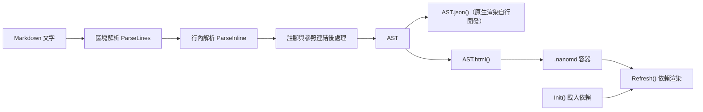

# 架構

NanoMD 把解析與渲染拆成互不相依的層：解析只產生資料，HTML 輸出與依賴渲染是可選的下游。

其他 JavaScript Markdown 函式庫各有定位：marked 是講求速度的解析器與編譯器，markdown-it 完整支援 CommonMark 並以語法外掛擴充，markdown-exit 是 markdown-it 的 TypeScript 改寫，showdown 可在 Markdown 與 HTML 之間雙向轉換，remark 是 unified 生態系中以外掛組成的處理器，micromark 是小巧且符合 CommonMark 的解析器；它們都透過外掛或擴充支援核心 Markdown 以外的語法。NanoMD 的做法不同：一次 `Parse()` 取得 AST，可用 `json()` 序列化成 JSON、用 `html()` 輸出經過跳脫與清理的 HTML；Mermaid 圖表、KaTeX 數學式與 Chart.js 圖表是內建語法，只有在 `Init()` 啟用時才從 CDN 載入對應函式庫。

## 系統概覽



## 分層

| 層 | 原始碼 | 職責 | 需要 DOM |
|---|---|---|---|
| 區塊解析 | `src/parser/index.ts`、`blockquote.ts`、`codeBlock.ts`、`heading.ts`、`list.ts`、`tableBlock.ts`、`footnote.ts` | 逐行判斷區塊類型，產生 `BlockNode` | 否 |
| 行內解析 | `src/parser/inline.ts`、`link.ts` | 程式碼、數學式、連結、樣式等行內節點 | 否 |
| 後處理 | `footnote.ts`、`link.ts` | 註腳編號、參照式連結還原 | 否 |
| HTML 輸出 | `src/parser/html.ts` | `AST.html()`、跳脫與 raw HTML 清洗 | 否 |
| 執行期 | `src/parser/refresh.ts`、`index.ts` 的 `Init()` | 載入依賴、渲染圖表／數學式／流程圖、綁定複製與檔案連結 | 是 |
| 樣式 | `src/sass/parser.scss` | `.nanomd` 容器樣式，編譯為 `parser.css` | — |

## 設計原則

| 原則 | 說明 |
|---|---|
| 資料與渲染分離 | `Parse()` 只回傳節點樹，`json()` 可複製成純資料交給 Web 以外的渲染器 |
| 單趟逐行 | 每行只判斷一次，耗時與文件大小成線性關係 |
| 跳脫在輸出時進行 | AST 保留原文，`html()` 才跳脫文字與屬性 |
| 依賴不自動載入 | Mermaid、KaTeX、Chart.js、prettify 只在 `Init()` 啟用時才載入 |
| 失敗退回程式碼 | 依賴未載入或語法錯誤時，區塊維持顯示一般程式碼區塊 |

模組級的完整圖表見 [doc/architecture.zh.md](https://github.com/pardnchiu/NanoMD/blob/main/doc/architecture.zh.md)；解析順序見 [解析流程](/zh/parsing-pipeline)。

```demo
<script>
  const ast = MDParser.Parse("# Title\n\nText with **bold**.");
  console.log(ast.map((node) => node.type).join(" -> "));
  console.log(ast.html());
</script>
```
