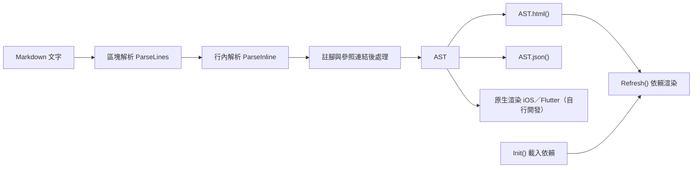

> [!NOTE]
> 此 README 由 [SKILL](https://github.com/agenvoy/skill-readme-generate) 生成，英文版請參閱 [這裡](https://github.com/pardnchiu/NanoMD/blob/main/README.md)。

---

<strong>FAST MARKDOWN TO AST AND HTML IN ONE PARSER!</strong>

---

> TypeScript Markdown 解析器，具備 JSON AST、按需載入的 Mermaid／KaTeX／Chart.js 渲染與安全的 HTML 輸出

## 目錄

- [功能特點](#功能特點)
- [效能比較](#效能比較)
- [Chrome 擴充功能](#chrome-擴充功能)
- [架構](#架構)
- [授權](#授權)
- [Author](#author)

## 功能特點

> `npm i @pardnchiu/nanomd` · [完整文件](https://github.com/pardnchiu/NanoMD/blob/main/doc/doc.zh.md) · [v1 停用說明](https://github.com/pardnchiu/NanoMD/blob/main/doc/v1-deprecated.zh.md) · [文件站](https://nanomd.pardn.io/)

- **單趟逐行解析** — 每行只掃描一次即建好整棵樹，4 MB 文件約 90 ms，比 v1 快 30 倍起，1 MB 文件差距超過 380 倍。
- **與渲染無關的 AST** — `Parse()` 回傳節點樹，`json()` 可複製成純資料，Web 與 SSR 直接用 `html()`，iOS、Flutter 等原生渲染可依同一份結果自行開發。
- **GFM 之外的擴充語法** — 註腳、參照式連結、GitHub 提示框、任務清單、行內與區塊數學式、圖片尺寸、影片嵌入與 `#tag` 連結皆內建。
- **依賴按需載入並自動退回** — 只載入啟用的 Mermaid、KaTeX、Chart.js、prettify；語法錯誤的區塊自動改顯示為一般程式碼區塊。
- **輸出即安全** — 文字與屬性在輸出時跳脫，raw HTML 移除危險標籤、事件屬性與 `javascript:` 網址。

## 效能比較

將[文件站](https://nanomd.pardn.io/zh/)的文件頁合併成一份文件，重複放大到各尺寸後，在 macOS 的 headless Chrome 155 以 v1.11.6、v2 與 marked 18.1.1 量測轉成 HTML 的耗時。每個案例先暖機 5 次，再連續執行至少 1.5 秒取平均；單次超過 3 秒只量一次，超過 15 秒記為超時。並排渲染與瀏覽器現場測速見[與 marked 比較](https://nanomd.pardn.io/zh/vs-marked)。

| 文件大小 | v1.11.6 `new MDParser().parse()` | v2 `Parse().html()` | marked `marked.parse()` | v1 / v2 | marked / v2 |
| -------- | -------------------------------- | ------------------- | ----------------------- | ------- | ----------- |
| 6.1 KB   | 3.23 ms                          | 0.097 ms            | 0.127 ms                | 33×     | 1.30×       |
| 42.2 KB  | 26.9 ms                          | 0.87 ms             | 1.08 ms                 | 31×     | 1.24×       |
| 405.2 KB | 1,402 ms                         | 9.15 ms             | 10.2 ms                 | 153×    | 1.11×       |
| 1.00 MB  | 8,853 ms                         | 23.1 ms             | 26.3 ms                 | 383×    | 1.14×       |
| 2.00 MB  | 超時（超過 15 秒）               | 44.6 ms             | 53.9 ms                 | 超時    | 1.21×       |
| 4.00 MB  | 超時（超過 15 秒）               | 88.3 ms             | 101.7 ms                | 超時    | 1.15×       |

## Chrome 擴充功能

> [Chrome 線上應用程式商店](https://chromewebstore.google.com/detail/nanomd/pdklinlfmpobpakengplkhbbneaamijd) · [使用說明](https://nanomd.pardn.io/zh/chrome-extension) · [隱私權政策](https://nanomd.pardn.io/zh/chrome-extension-privacy)

在 Chrome 開啟本機 `.md` 或 `.markdown` 檔案，NanoMD 會以本解析器渲染：左側是原始碼編輯區，右側預覽隨輸入即時更新，Mermaid、KaTeX、Chart.js 與程式碼高亮皆打包在擴充功能內。按 `Cmd/Ctrl + S` 把編輯內容寫回選定的檔案，分頁標題出現 `●` 表示尚未存檔。

> [!IMPORTANT]
> Chrome 預設不讓擴充功能存取 `file://` 頁面。安裝後開啟 `chrome://extensions`，在 NanoMD 點 **詳細資料**，開啟 **允許存取檔案網址**；未開啟時檔案只會以純文字顯示。

## 架構

> [完整架構](https://github.com/pardnchiu/NanoMD/blob/main/doc/architecture.zh.md)

## 授權

本專案採用 [MIT LICENSE](https://github.com/pardnchiu/NanoMD/blob/main/LICENSE)。

## Author

Just [open an issue](https://github.com/pardnchiu/NanoMD/issues/new) to share an idea.

---

©️ 2024 [邱敬幃 Pardn Chiu](https://www.linkedin.com/in/pardnchiu)
