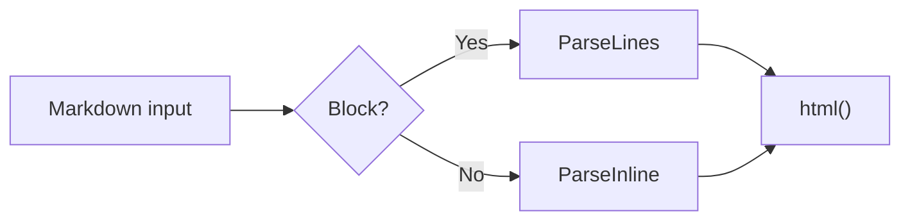
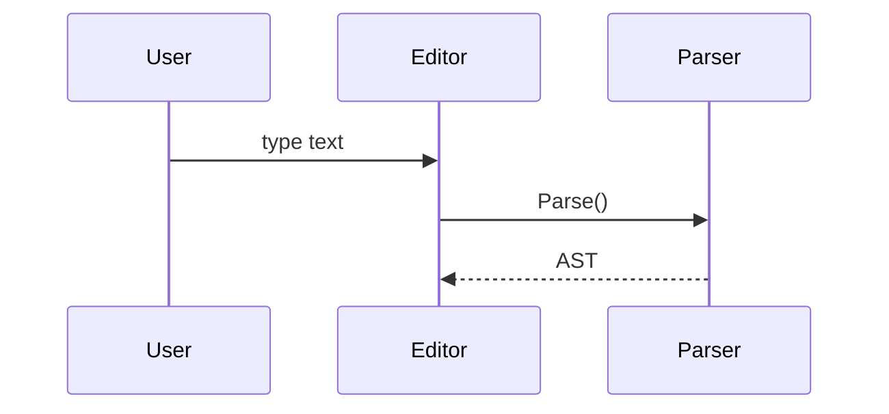
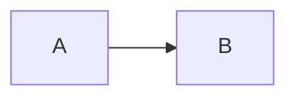

# Code and Diagrams

This page covers the fence rules for code blocks and the three blocks that get extra rendering: `mermaid`, `math` and `chartjs`.

## Fences

| Rule | Description |
|---|---|
| Opening | 3 or more `` ` `` or `~`, optionally followed by a language tag |
| Closing | The same character, at least as many as the opening |
| Nesting | Use a longer or different fence outside; an inner ` ``` ` does not close it early |
| Language tag | Lowercased; common languages get a `language-xxx` class for highlighting and a label in the top-left corner |
| Indentation | Aligned to the first line; the same width is removed from every line |
| Unclosed | Runs to the end of the document, without a language tag |

Every code block has a copy button that shows `copied` for a second after a click, and `OnCopyClick` receives the result; see [API Reference](/parser-api).

## Blocks with Extra Rendering

The language tag must equal one of these exactly (`mermaid-js`, `latex` and the like are plain code blocks):

| Tag | Renderer | Content |
|---|---|---|
| `mermaid` | Mermaid | Flowcharts, sequence diagrams and other Mermaid syntax |
| `math` | KaTeX | Block math |
| `chartjs` | Chart.js | JSON with a string `type` and an object `data` |

These blocks show only a plain code block until `Refresh()` renders them; with invalid syntax, an incomplete `chartjs` config or a missing dependency, they keep showing the code block.

## Examples

### Fences

Backtick and tilde fences, nested fences, longer closing fences and a fence right after a list.

``````demo
<div id="out" class="nanomd"></div>
<script type="text/markdown" id="md">
```js
const a = "<b>not converted</b>";
```

~~~js
const b = "~~~ is also a code block";
~~~

~~~md
Inside ~~~ you can write ``` as is; only ~~~ closes it
```js
const c = 1;
```
~~~

````md
An outer fence of 4 backticks is not closed early by ```
```chartjs
{ "type": "bar" }
```
````

```
A closing fence can be longer
`````

- List item
~~~
~~~ right after a list is not merged into the item
~~~
</script>
<script>
  const out = document.getElementById("out");
  out.innerHTML = MDParser.Parse(document.getElementById("md").textContent).html();
  MDParser.Init({ enable: { highlight: true } })
    .then(() => MDParser.Refresh(out))
    .catch((err) => console.error(err.message));
</script>
``````

### Mermaid

A flowchart and a sequence diagram.

````demo
<div id="out" class="nanomd"></div>
<script type="text/markdown" id="md">



</script>
<script>
  const out = document.getElementById("out");
  out.innerHTML = MDParser.Parse(document.getElementById("md").textContent).html();
  MDParser.Init({ enable: { mermaid: true } })
    .then(() => MDParser.Refresh(out))
    .catch((err) => console.error(err.message));
</script>
````

### Block Math

A KaTeX display formula.

````demo
<div id="out" class="nanomd"></div>
<script type="text/markdown" id="md">
```math
\int_0^\infty e^{-x^2} \, dx = \frac{\sqrt{\pi}}{2}
```
</script>
<script>
  const out = document.getElementById("out");
  out.innerHTML = MDParser.Parse(document.getElementById("md").textContent).html();
  MDParser.Init({ enable: { latex: true } })
    .then(() => MDParser.Refresh(out))
    .catch((err) => console.error(err.message));
</script>
````

### Chart.js

Bar, pie and bubble charts from JSON.

````demo
<div id="out" class="nanomd"></div>
<script type="text/markdown" id="md">
```chartjs
{
  "type": "bar",
  "data": {
    "labels": ["Red", "Blue", "Yellow", "Green", "Purple", "Orange"],
    "datasets": [{ "label": "# test", "data": [12, 19, 3, 5, 2, 3] }]
  }
}
```

```chartjs
{
  "type": "pie",
  "data": {
    "labels": ["A", "B", "C"],
    "datasets": [{ "data": [30, 50, 20] }]
  }
}
```

```chartjs
{
  "type": "bubble",
  "data": {
    "datasets": [
      { "label": "A", "data": [{ "x": 10, "y": 20, "r": 8 }, { "x": 25, "y": 35, "r": 15 }, { "x": 40, "y": 10, "r": 5 }] },
      { "label": "B", "data": [{ "x": 15, "y": 30, "r": 10 }, { "x": 30, "y": 15, "r": 12 }, { "x": 45, "y": 40, "r": 6 }] }
    ]
  }
}
```
</script>
<script>
  const out = document.getElementById("out");
  out.innerHTML = MDParser.Parse(document.getElementById("md").textContent).html();
  MDParser.Init({ enable: { chartjs: true } })
    .then(() => MDParser.Refresh(out))
    .catch((err) => console.error(err.message));
</script>
````

### Exact Language Tags

Only `mermaid`, `math` and `chartjs` get extra rendering; these stay plain code blocks.

````demo
<div id="out" class="nanomd"></div>
<script type="text/markdown" id="md">
```latex
E = mc^2
```

```mathjax
E = mc^2
```


</script>
<script>
  const out = document.getElementById("out");
  out.innerHTML = MDParser.Parse(document.getElementById("md").textContent).html();
  MDParser.Init({ enable: { mermaid: true, latex: true, highlight: true } })
    .then(() => MDParser.Refresh(out))
    .catch((err) => console.error(err.message));
</script>
````

### Fallbacks

Invalid Mermaid, invalid math, a chart without `data` and an unregistered chart type all fall back to code blocks.

````demo
<div id="out" class="nanomd"></div>
<script type="text/markdown" id="md">
```mermaid
This is not Mermaid syntax
```

```math
\frac{1}{
```

```chartjs
{ "type": "bar" }
```

```chartjs
{ "type": "unknown", "data": { "datasets": [{ "data": [1, 2, 3] }] } }
```
</script>
<script>
  const out = document.getElementById("out");
  out.innerHTML = MDParser.Parse(document.getElementById("md").textContent).html();
  MDParser.Init({ enable: { mermaid: true, latex: true, chartjs: true } })
    .then(() => MDParser.Refresh(out))
    .then(() => { console.log("rendered:", out.querySelectorAll("[data-rendered]").length, "code blocks:", out.querySelectorAll(".nanomd > pre.prettyprint").length); })
    .catch((err) => console.error(err.message));
</script>
````
