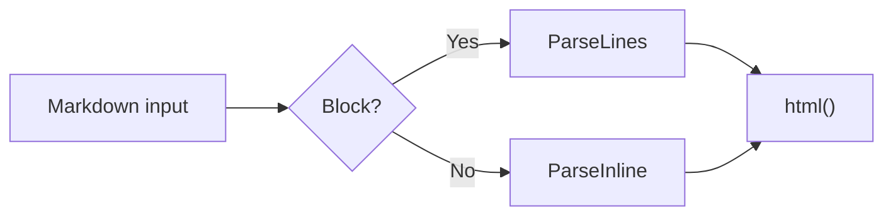
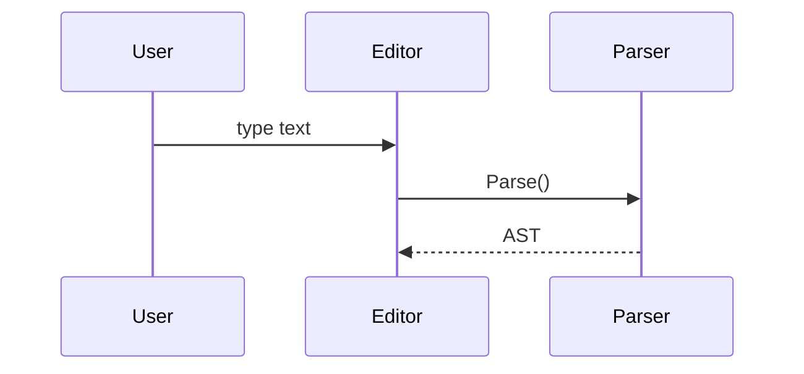
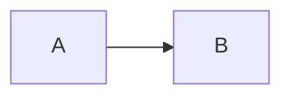

# 程式碼與圖表

本頁涵蓋程式碼區塊的圍欄規則，以及 `mermaid`、`math`、`chartjs` 三種會另外渲染的區塊。

## 圍欄

| 規則 | 說明 |
|---|---|
| 開頭 | 3 個以上的 `` ` `` 或 `~`，後面可接語言標籤 |
| 結尾 | 同一種字元，數量不少於開頭 |
| 巢狀 | 外層用較長或不同字元的圍欄，內層的 ` ``` ` 不會提早結束 |
| 語言標籤 | 轉小寫；常見語言加上 `language-xxx` class 供上色，並顯示在區塊左上角 |
| 縮排 | 依第一行的縮排對齊，整段向左移除同樣寬度 |
| 未閉合 | 讀到文件結尾為止，不帶語言標籤 |

每個程式碼區塊都附複製按鈕，點擊後顯示 `copied` 一秒，結果可用 `OnCopyClick` 接收，見 [API 參考](/zh/parser-api)。

## 會另外渲染的區塊

語言標籤需完全等於下列值（`mermaid-js`、`latex` 等都是一般程式碼區塊）：

| 標籤 | 渲染器 | 內容 |
|---|---|---|
| `mermaid` | Mermaid | 流程圖、序列圖等 Mermaid 語法 |
| `math` | KaTeX | 區塊數學式 |
| `chartjs` | Chart.js | JSON，需有字串 `type` 與物件 `data` |

這三種區塊在 `Refresh()` 渲染成功前只顯示一般程式碼區塊；語法錯誤、`chartjs` 設定不完整或依賴未載入時，維持顯示程式碼區塊。

## 範例

### 圍欄

反引號與波浪號圍欄、巢狀圍欄、較長的結尾圍欄，以及緊接在清單後的圍欄。

``````demo
<div id="out" class="nanomd"></div>
<script type="text/markdown" id="md">
```js
const a = "<b>not converted</b>";
```

~~~js
const b = "~~~ is also a code block";
~~~

~~~md
Inside ~~~ you can write ``` as is; only ~~~ closes it
```js
const c = 1;
```
~~~

````md
An outer fence of 4 backticks is not closed early by ```
```chartjs
{ "type": "bar" }
```
````

```
A closing fence can be longer
`````

- List item
~~~
~~~ right after a list is not merged into the item
~~~
</script>
<script>
  const out = document.getElementById("out");
  out.innerHTML = MDParser.Parse(document.getElementById("md").textContent).html();
  MDParser.Init({ enable: { highlight: true } })
    .then(() => MDParser.Refresh(out))
    .catch((err) => console.error(err.message));
</script>
``````

### Mermaid

流程圖與序列圖。

````demo
<div id="out" class="nanomd"></div>
<script type="text/markdown" id="md">



</script>
<script>
  const out = document.getElementById("out");
  out.innerHTML = MDParser.Parse(document.getElementById("md").textContent).html();
  MDParser.Init({ enable: { mermaid: true } })
    .then(() => MDParser.Refresh(out))
    .catch((err) => console.error(err.message));
</script>
````

### 區塊數學式

KaTeX 區塊公式。

````demo
<div id="out" class="nanomd"></div>
<script type="text/markdown" id="md">
```math
\int_0^\infty e^{-x^2} \, dx = \frac{\sqrt{\pi}}{2}
```
</script>
<script>
  const out = document.getElementById("out");
  out.innerHTML = MDParser.Parse(document.getElementById("md").textContent).html();
  MDParser.Init({ enable: { latex: true } })
    .then(() => MDParser.Refresh(out))
    .catch((err) => console.error(err.message));
</script>
````

### Chart.js

以 JSON 設定的長條圖、圓餅圖與泡泡圖。

````demo
<div id="out" class="nanomd"></div>
<script type="text/markdown" id="md">
```chartjs
{
  "type": "bar",
  "data": {
    "labels": ["Red", "Blue", "Yellow", "Green", "Purple", "Orange"],
    "datasets": [{ "label": "# test", "data": [12, 19, 3, 5, 2, 3] }]
  }
}
```

```chartjs
{
  "type": "pie",
  "data": {
    "labels": ["A", "B", "C"],
    "datasets": [{ "data": [30, 50, 20] }]
  }
}
```

```chartjs
{
  "type": "bubble",
  "data": {
    "datasets": [
      { "label": "A", "data": [{ "x": 10, "y": 20, "r": 8 }, { "x": 25, "y": 35, "r": 15 }, { "x": 40, "y": 10, "r": 5 }] },
      { "label": "B", "data": [{ "x": 15, "y": 30, "r": 10 }, { "x": 30, "y": 15, "r": 12 }, { "x": 45, "y": 40, "r": 6 }] }
    ]
  }
}
```
</script>
<script>
  const out = document.getElementById("out");
  out.innerHTML = MDParser.Parse(document.getElementById("md").textContent).html();
  MDParser.Init({ enable: { chartjs: true } })
    .then(() => MDParser.Refresh(out))
    .catch((err) => console.error(err.message));
</script>
````

### 語言標籤需完全相同

只有 `mermaid`、`math`、`chartjs` 會另外渲染，以下維持一般程式碼區塊。

````demo
<div id="out" class="nanomd"></div>
<script type="text/markdown" id="md">
```latex
E = mc^2
```

```mathjax
E = mc^2
```


</script>
<script>
  const out = document.getElementById("out");
  out.innerHTML = MDParser.Parse(document.getElementById("md").textContent).html();
  MDParser.Init({ enable: { mermaid: true, latex: true, highlight: true } })
    .then(() => MDParser.Refresh(out))
    .catch((err) => console.error(err.message));
</script>
````

### 退回程式碼區塊

Mermaid 語法錯誤、數學式錯誤、圖表缺 `data` 與未註冊的圖表類型，都退回一般程式碼區塊。

````demo
<div id="out" class="nanomd"></div>
<script type="text/markdown" id="md">
```mermaid
This is not Mermaid syntax
```

```math
\frac{1}{
```

```chartjs
{ "type": "bar" }
```

```chartjs
{ "type": "unknown", "data": { "datasets": [{ "data": [1, 2, 3] }] } }
```
</script>
<script>
  const out = document.getElementById("out");
  out.innerHTML = MDParser.Parse(document.getElementById("md").textContent).html();
  MDParser.Init({ enable: { mermaid: true, latex: true, chartjs: true } })
    .then(() => MDParser.Refresh(out))
    .then(() => { console.log("rendered:", out.querySelectorAll("[data-rendered]").length, "code blocks:", out.querySelectorAll(".nanomd > pre.prettyprint").length); })
    .catch((err) => console.error(err.message));
</script>
````
